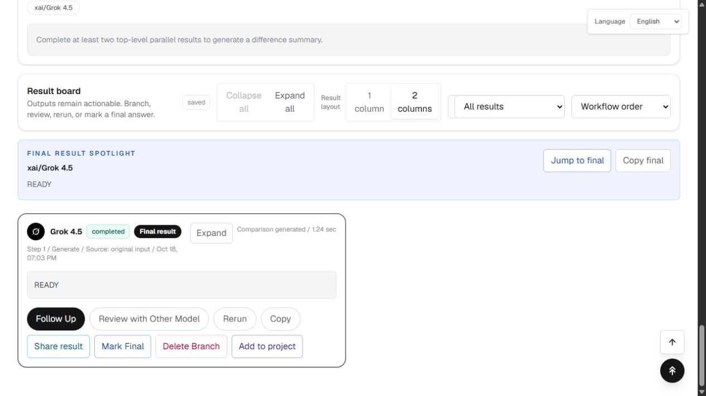

# Yapp 웹앱 출시 최종 보완

- 버전: `v1.38.5-20261018`
- 날짜: 2026-10-18 (한국 시간)
- 공개 주소: https://yapp.wideget.net
- 이전 출시: `v1.38.4-20261018`, 소스 `3a52d9bf127803707c9269d91609e82fc5b43d5b`, Vercel `dpl_37HR471hrnDb6YXgvEFSK6oSDuxy`.
- 출시 PR: https://github.com/LuckTone79/Qkiki/pull/39

## 문제와 수정

실제 출시 후 체험 워크벤치 진입을 점검하며 `/api/trial/start`가 IP 해시만으로 기존 체험 계정의 새 세션을 발급하는 경로를 확인했다. 공유 네트워크의 다른 방문자를 같은 사용자로 취급할 수 있으므로 제거했다. 기존 인증 세션이 있을 때만 해당 체험을 계속하며, 인증 세션이 없고 동일 IP의 체험 기록만 있으면 401과 로그인 안내를 반환한다. 처음 방문하는 네트워크의 신규 체험과 유효한 기존 세션은 보존한다. 스키마와 기존 데이터는 변경하지 않는다.

## 검증

- 실제 라우트 POST를 실행하는 회귀 4개: IP만으로 세션 발급 금지, 유효한 기존 체험 보존, 신규 체험 발급, IP 누락 거절.
- 전체 테스트: 209 통과, 실패 0.
- ESLint 통과. TypeScript `--noEmit --incremental false` 통과. 최종 코드의 Next.js 빌드와 빌드 내 타입 검사 통과.
- 신규 staged 변경 Gitleaks 검사: 탐지 0건.
- 브라우저의 실제 단일 GPT-5.4 Nano 요청은 관리자 대체 설정에 따라 Grok 4.5가 실행되어 `READY`를 반환했다. 저장 결과 완료 1개, 실패 0개, 실제 1크레딧 차감 확인. OpenAI 직접 호출 성공이나 모든 모델별 성공의 증거로 해석하지 않는다.
- 최종 배포 및 라이브 결과는 완료 후 아래에 기록한다.
- 이전 버전 라이브: 공개 대문/로그인/가입/가이드/인증 구성 200, 비로그인 워크벤치 307, 세션 API 401. 브라우저 체험 워크벤치와 표시 버전 확인. 배포 오류 로그 조회 결과 없음.

## GitHub 우선 조사

- 2026-10-18 검색어: `site:github.com/OWASP/CheatSheetSeries Session Management IP address session ID authentication`.
- 원본 지침: https://github.com/OWASP/CheatSheetSeries/blob/master/cheatsheets/Session_Management_Cheat_Sheet.md — 세션 식별자와 인증/접근 제어 경계 참고.
- 기존 프로젝트 인증 세션과 Prisma 경로를 재사용한다. 작은 내부 인가 수정이므로 별도 프로그램/인증 SDK/키트 교체가 필요하지 않다. 배포 도구 조사와 선택은 직전 출시 보고서를 재사용한다.

## 저장소와 출시 경계

기본 main 직접 푸시는 자동 승인 검토에서 거부되었다. 이유는 출시 요청만으로 기본 브랜치 직접 변경 승인이 명시되었다고 볼 수 없으며, PR 또는 검토 가능한 별도 브랜치 배포가 더 안전하다는 것이다. 허용된 별도 출시 브랜치에 커밋·푸시하고 draft PR을 만들었다. 사용자가 요청한 기존 웹앱 프로덕션 출시는 Vercel 후보 배포 검증과 승격으로 진행한다. main 병합은 수행하지 않았다.

개인 계정 OAuth 동의·콜백, 이메일 실제 수신, 결제와 모든 AI 모델별 실행은 별도 증거가 필요하다. 이번 확인을 해당 E2E의 완료로 보고하지 않는다.

## 최종 출시 증거

- 출시 소스 커밋: `489f32071f0a0b1e13ae87a2d7faa7bdc1515950`.
- Vercel 최종 배포: `dpl_CEKsMgsuquCwSP9tq8sGBgGmRQsh`, **Ready**, https://qkiki-nu526a52v-lucktone79s-projects.vercel.app . 운영 도메인 승격 완료.
- 한국 시간 2026-10-18 19시대에 https://yapp.wideget.net/guide 및 브라우저 워크벤치에서 `v1.38.5-20261018` 확인.
- 운영 대문/로그인/가입/가이드/인증 구성 API: 200. 인증 없는 워크벤치: 307 로그인 이동. 인증 없는 세션 목록: 401.
- 운영 `/api/trial/start`에 인증 쿠키 없이 요청하고 반복 요청하여 401 및 **체험 세션 미발급** 확인. 기존 브라우저 세션은 유지되어 새 배포에서 저장 결과 `READY`를 다시 읽었다.
- 검증용 AI 실행 DB 읽기: `completed`, 계획 1개/완료 1개, 종료 시각 존재. 신규 실행이나 후속 유료 요청을 추가하지 않았다.
- 원격 빌드: 컴파일/타입 검사/배포 완료. 운영 마이그레이션: `No pending migrations to apply`.
- 최종 배포 최근 10분 error 로그: 조회 결과 없음. 이는 이후 무오류를 보장하거나 상시 모니터링을 설치했다는 뜻은 아니다.
- 원래 작업 폴더의 미커밋 변경은 보존했다. 출시 소스는 별도 브랜치에 푸시되어 있으며 main 병합은 수행하지 않았다.

## 확인된 표시 제한

완료된 세션을 새로 읽는 동안 진행 패널에 기본 모델들의 진행 표시가 남는 현상이 관찰됐다. 결과 카드/저장 응답과 DB 실행 상태는 완료 1개이며, 추가 실제 실행이 남은 것으로 판단하지 않았다. 진행 표시 정리는 후속 UI 개선 항목으로 남긴다. 신규 방문 네트워크의 첫 체험 발급은 회귀 테스트로 확인했고, 운영에서는 이미 체험 기록이 있는 네트워크의 미인증 복구 차단을 확인했다.
